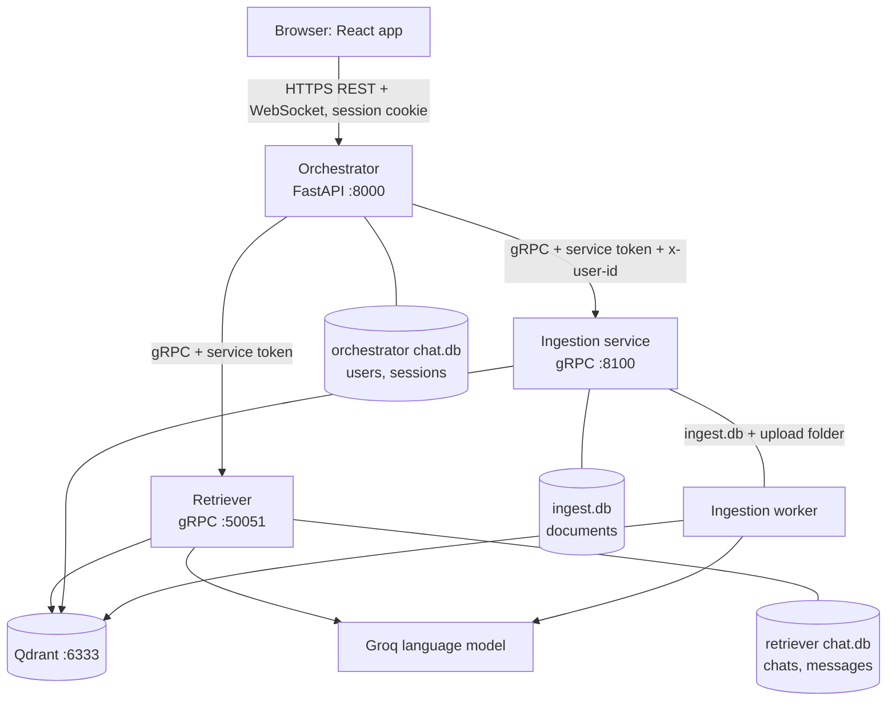
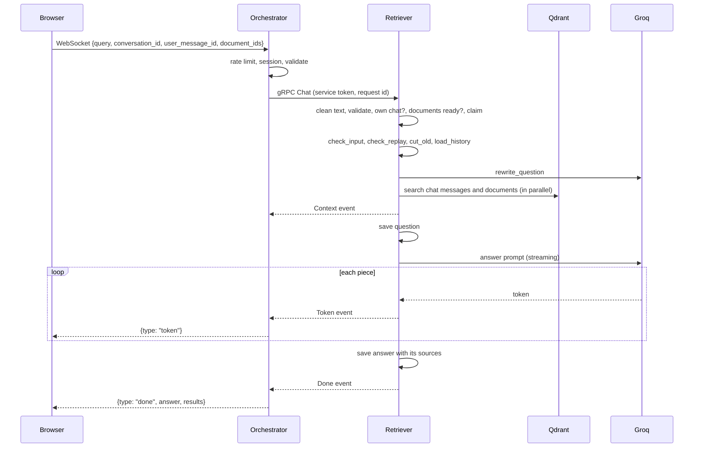
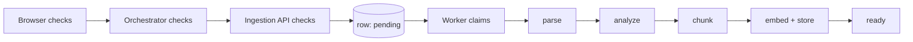
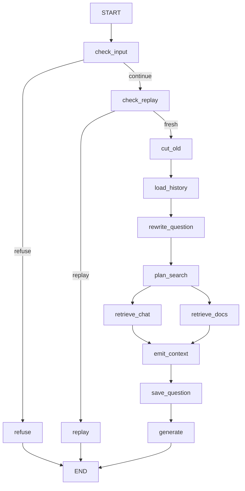

# INFO MATE: Complete Project Guide

How the app is built, how every input moves through it, what every function and graph node does, and how it is protected.

Written from the source code on the `langraph-implement` branch (26 November 2026). Where this guide and the code disagree, the code is right.

## Contents

1. [What the app does](#1-what-the-app-does)
2. [Architecture](#2-architecture)
3. [How each input flows](#3-how-each-input-flows)
4. [The LangGraph chat turn, node by node](#4-the-langgraph-chat-turn-node-by-node)
5. [Backend code, file by file](#5-backend-code-file-by-file)
6. [Frontend code, file by file](#6-frontend-code-file-by-file)
7. [Interfaces between the parts](#7-interfaces-between-the-parts)
8. [Stored data](#8-stored-data)
9. [Security](#9-security)
10. [Known gaps and bugs](#10-known-gaps-and-bugs)
11. [Settings](#11-settings)
12. [Run, test, deploy](#12-run-test-deploy)
13. [Word list](#13-word-list)

---

## 1. What the app does

A chat app with a memory:

- Sign up and log in.
- Ask questions; the answer streams in word by word, and can be stopped.
- Edit a question or regenerate an answer.
- The app searches older messages of the same chat and adds the relevant ones.
- Upload PDF, DOCX, TXT or MD files and ask about them.
- Answers cite the file excerpts as clickable `[C1]` labels.
- Chat text and document text are encrypted where they are stored.

---

## 2. Architecture

### 2.1 The parts



| Part | Folder | Job | Talks to |
|---|---|---|---|
| Frontend | `frontend/` | Screens | Orchestrator only |
| Orchestrator | `backend/orchestrator/` | The only public door: login, sessions, rate limits, forwarding | Retriever, Ingestion |
| Retriever (chat service) | `backend/retriever/` | Searches, builds the prompt, calls the model, saves the chat | Qdrant, Groq |
| Ingestion API | `backend/ingestion/main.py` | Accepts, lists and deletes documents | Qdrant (delete) |
| Ingestion worker | `backend/ingestion/worker.py` | Reads, cuts, embeds and stores documents | Qdrant, Groq |
| Shared code | `backend/shared_common/` | Encryption, embeddings, cleaning, logging, token checks | A library, not a service |
| gRPC contracts | `backend/proto/chat.proto`, `ingest.proto` | Messages between orchestrator and retriever, and orchestrator and ingestion | Generated into `*_pb2*.py` |
| Qdrant | `docker-compose.yml` | Search index | — |

### 2.2 Why it is split this way

- The browser can reach only the orchestrator. The other services trust the user id they are given, so they must stay private.
- Each service owns its own SQLite file. No service reads another's database.
- Embedding work (Gemini API calls and the keyword model) lives in the retriever and the worker. The orchestrator and the ingestion API stay light.
- A slow document upload cannot block chat: the worker is a separate, low priority process.

### 2.3 AI models

| Use | Model |
|---|---|
| Meaning (dense) vectors, 768 numbers | `gemini-embedding-2` (Google Gemini API) |
| Keyword (sparse) vectors | `Qdrant/bm25` |
| Writing answers and rewriting questions | Groq, `openai/gpt-oss-120b` (`GROQ_MODEL`) |
| Choosing how to cut a document | `INGEST_ANALYSIS_MODEL`, same default |

---

## 3. How each input flows

### 3.1 Sign up and log in

1. `LoginPage` posts to `/api/signup` or `/api/login` with `credentials: "include"`.
2. The orchestrator validates the body (name 2–50 characters, valid email, password at least 8 on sign up).
3. Sign up: refuses a known email (409), stores the user with an argon2 password hash. Log in: checks the hash; a wrong email or password gives the same 401.
4. `create_session` makes a random token, stores only its SHA-256 hash with an expiry, and removes that user's expired sessions.
5. The token goes back in an HttpOnly cookie named `session_id`.
6. The browser keeps only name, email and user id in `localStorage` for display.
7. On the next app start, `App` calls `/api/me`. A 401 sends the user to the login page.

### 3.2 A chat question, end to end



1. **Browser** (`ChatPage.handleSend`): trims to 4000 characters, creates a message id, shows the question as "pending", and calls `send` in `useChatSocket`.
2. **Orchestrator** (`websocket.chat`), in this order: JSON check → rate limit (10 messages per 60 s per user) → session still valid → session extended → query not empty → message id is a UUID → at most 5 document UUIDs → no answer already running in this chat → at most 3 chats answering at once.
3. It starts a task (`answer_question`) so that "cancel" can still be read.
4. **Retriever** (`ChatServicer.Chat`): removes hidden characters, requires user id, chat id and query, limits length to 4000, checks ids.
5. `run_turn` checks ownership and documents, claims the question, then runs the graph ([section 4](#4-the-langgraph-chat-turn-node-by-node)).
6. Events flow back: one `context`, many `token`, one `done`.
7. **Browser**: the first token creates the answer bubble; "done" replaces its text with the saved answer and attaches the sources, which turns `[C1]` labels into buttons.

If the request fails, the partly written bubble is removed and the question is marked "Not sent" with a Retry button.

### 3.3 Stop

Browser sends `{"type":"cancel"}` → orchestrator cancels the task (only after the context event, while streaming) → the gRPC call is cancelled → `node_generate` saves what was written, shielded from a second cancel → the orchestrator sends `done` with the partial answer and `cancelled: true`.

### 3.4 Retry, edit, regenerate

All three resend the **same** `user_message_id`.

| Action | Sent | What the retriever does |
|---|---|---|
| Retry (nothing answered) | same id, same text | Deletes that message and later ones, answers again |
| Retry (already answered) | same id, same text | Replays the saved answer, no model call |
| Edit | same id, new text | Deletes from that message on, answers the new text |
| Regenerate | same id, `regenerate: true` | Deletes from that message on, answers again |

Deleting removes the search index entries first, then the database rows. If the first step fails, nothing is lost and the request can be repeated.

### 3.5 Uploading a document



1. **Browser** (`checkFile`): allowed extension, not empty, within size limit.
2. **Orchestrator** (`documents.upload_document`): 5 uploads per 60 s → declared size → one file only → extension → real size while copying → not empty. The user id comes from the session, never the form.
3. **Ingestion API** (`service.DocumentService.Upload`): token → clean file name → extension → size and SHA-256 while copying → file content matches its type → same user and file already there? (returns it) → at most 20 documents per user → move file into place → create the row (202).
4. **Worker** (`jobs.process_document`):

| Stage | What happens |
|---|---|
| parsing | Parsed in a child process with a 60 s limit into blocks (heading, paragraph, list, table, code); hidden characters removed; statistics computed |
| analyzing | Up to 300 tokens: kept whole. Otherwise the model sees statistics and short samples and recommends a strategy; its answer is checked and clamped; any failure uses fixed rules |
| chunking | Deterministic cutting, then checks. A failed check falls back to the recursive strategy |
| embedding | Batches of 32 chunks, stored encrypted with status `processing` |
| storing | Report saved, all chunks switched to `ready` in one call, row set to `ready` |

5. The uploaded file is deleted whatever the outcome. A failure stores only a short code.
6. The browser polls the list every 2 s while anything is pending or processing, then shows a toast.

If the user deletes a document mid-job, the worker notices, removes its chunks and never overwrites the deletion. A job stuck longer than twice `INGEST_JOB_TIMEOUT_SECONDS` is queued again.

### 3.6 Asking about documents, and citations

- Ticked documents (at most 5) are searched. If none are ticked, **all** of the user's ready documents are searched.
- Excerpts go into the prompt as `[C1] [report.pdf, part 3] text`. The number is the excerpt's position in the result list.
- The model writes the label after the sentence it supports.
- The browser counts the same document excerpts in the same order, so `C2` is the second one. Past chat messages are not counted.
- Clicking a label opens a popover with the file name, section, page, part, and the sentence of the excerpt that shares the most words with the claim, with those words highlighted. This sentence choice is a word-overlap guess. If too little matches, the whole excerpt is shown and labelled as such.
- A label with no matching excerpt stays as plain text.
- Old answers written as `[Source: file]` still show the Sources list.

### 3.7 Chat list, history and delete

| Input | Path |
|---|---|
| Sidebar list | `GET /api/conversations` → gRPC `ListConversations` → newest activity first, 20 per page, cursor paging |
| Open a chat | `GET /api/conversations/{id}/messages` → gRPC `ListMessages` → 30 per page, oldest first inside a page, with saved sources |
| Delete a document | `DELETE /api/documents/{id}` → mark `deleting` → delete chunks → delete file and row |
| Delete a chat (API) | `DELETE /api/conversations/{id}` → ownership → delete search entries → delete rows |
| Delete a chat (screen) | Only hides it in this browser, see [gaps](#10-known-gaps-and-bugs) |
| Log out | `POST /api/logout` deletes the session and clears the cookie |

### 3.8 Request tracing

Each HTTP request and each question gets a short request id. It is sent on to the other services (`x-request-id`) and appears in every log line, so one question can be followed across services.

---

## 4. The LangGraph chat turn, node by node

Files: `backend/retriever/turn.py` (nodes) and `turn_graph.py` (wiring).

### 4.1 Before the graph (`run_turn`)

1. `get_or_create_conversation`: refuse a chat owned by someone else. A new chat is created here, titled with the first 40 characters of the question.
2. `_check_documents`: chosen documents must exist, belong to the user and be ready.
3. `_claim`: only one turn per (chat, question id). A second one waits up to 60 s.

Afterwards `_release` always runs.

### 4.2 The graph



### 4.3 The state

| Key | Meaning | Written by |
|---|---|---|
| `user_id`, `conversation_id`, `query`, `user_message_id`, `regenerate`, `document_ids` | Inputs | `run_turn` |
| `injection_found` | Question looks like an injection | `check_input` |
| `saved` | What is already stored for this question id | `check_replay` |
| `history` | Earlier messages of this chat | `load_history` |
| `search_query` | Rewritten question, used only for search | `rewrite_question` |
| `library` | The user's documents | `rewrite_question` or `plan_search` |
| `vectors` | The embedded search query | `plan_search` |
| `chat_results` | Related older messages | `retrieve_chat` |
| `doc_results` | Document excerpts | `retrieve_docs` |
| `results` | Both together | `emit_context` |
| `user_message_id` | Id of the saved question | `save_question` |
| `answer`, `assistant_message_id` | Outputs | `generate` (`answer` also by `refuse`) |

Events (`Context`, `Token`, `Done`) are sent through LangGraph's custom stream, not stored in the state.

### 4.4 Each node

**`node_check_input`** — Looks for prompt injection phrases in the question with `find_injection`. Sets `injection_found`. Logs only that it refused, never the text.

**`route_after_input`** (router) — `refuse` or `continue`.

**`node_refuse`** — Sends an empty context, a fixed refusal text and `Done`. No search, no model call, and no message saved, so the refusal disappears after a reload. Nothing old is deleted. (A brand new chat was already created before the graph, with its title taken from the question.)

**`node_check_replay`** — If the browser sent a question id and did not ask to regenerate, reads what is saved for it (`get_turn_state`).

**`route_after_check`** (router) — `replay` when an answer exists and the text is identical, else `fresh`.

**`node_replay`** — Sends the saved context, the saved answer as one token, and `Done`. No model call.

**`node_cut_old`** — For edit, regenerate and retry: `_cut_from` deletes that message and everything after it.

**`node_load_history`** — Reads the latest 20 messages, oldest first, before the new question is saved.

**`node_rewrite_question`** — Asks the model to rephrase the question for search: resolve "it" and "this" from the history, and expand abbreviations.

- Sends the last 6 messages, each cut to 500 characters, with `<conversation>` tags stripped.
- Temperature 0; low reasoning effort for `gpt-oss` models.
- Skipped for a question over 1000 characters, or when there is no history and there are no documents.
- Uses the original question on failure, after `REWRITE_TIMEOUT_SECONDS` (5), or when the reply is empty, too long, or looks like an injection.

**`node_plan_search`** — Lists the user's documents if none were chosen (reusing the list from the rewrite node), then embeds the search query once. No documents at all: no embedding here (the chat search embeds on its own).

**`node_retrieve_chat`** — Hybrid search over this user's messages in this chat. Asks for extra results, drops those already in the history, keeps 5.

**`node_retrieve_docs`** — Excerpts of the chosen documents, or of all documents. Asks for 6 plus neighbouring chunks. Runs at the same time as the chat search.

**`node_emit_context`** — Waits for both searches, then sends one `Context` event: chat messages first, then excerpts.

**`node_save_question`** — Saves the question (original words) and indexes it in the background. It runs after the searches so a question cannot find itself.

**`node_generate`** — Calls `stream_response`, sends tokens, then saves the answer with its sources.

- Streaming and saving are one node so that Stop still saves.
- If the model fails, no answer is saved.
- Logs how long the first token took.
- Passes document names to the model when no document was chosen.

### 4.5 Helper functions in `turn.py`

| Function | Does |
|---|---|
| `DocumentNotFound`, `DocumentNotReady`, `TurnInProgress` | Errors turned into gRPC statuses |
| `Context`, `Token`, `Done` | The three event types |
| `drop_messages_already_in_history` | Avoids sending a message twice |
| `_spawn` | Starts a background task and keeps it alive |
| `_index` | Adds a message to Qdrant if its chat still exists; failures are only logged |
| `_retrieve`, `_retrieve_documents`, `_embed`, `_list_library` | Safe wrappers: on failure the chat still answers. At most 4 run at once |
| `_check_documents` | Ownership and readiness |
| `context_for_storage` | The shape saved with an answer |
| `_save_answer` | Saves and indexes the answer |
| `_cut_from` | Deletes a message and all later ones |
| `_claim`, `_release` | One turn per question |
| `answer_id_for` | A fixed answer id per question, so no double answers |
| `_results_from_saved`, `_replay` | Rebuild events from storage |
| `_logged` | One log line per node with its duration |
| `_without_conversation_tags`, `_rewrite_messages`, `_ask_rewriter`, `_rewrite` | The question rewriter |
| `_writer` | Gets LangGraph's event writer |
| `_TokenSender` (`add`, `flush`) | Sends tokens at once, or merged if `TOKEN_COALESCE_MS` is above 0 |
| `_graph_nodes` | Hands the node functions to the graph builder |
| `run_turn` | The whole turn as an async generator |

`turn_graph.build` wires the nodes (no checkpointer). `turn_graph.get_graph` builds it once and reuses it.

---

## 5. Backend code, file by file

### 5.1 Shared library (`shared_common/common/`)

| File | Function | Does |
|---|---|---|
| `settings.py` | constants | Model names, vector size, collection names, id namespace (never change it) |
| `crypto.py` | `_keys`, `check_configured` | Load keys; fail at start if missing |
| | `encrypt`, `decrypt`, `rekey`, `is_encrypted` | Fernet with the `enc:v1:` prefix; first key encrypts, all decrypt |
| | `EncryptedText` | A database column that encrypts and decrypts by itself |
| | `python crypto.py genkey` | Prints a new key |
| `embeddings.py` | `get_dense`, `get_sparse`, `warm_up` | Gemini client and keyword model, made on first use; `warm_up` also checks the API key |
| | `embed_messages`, `embed_passages` | Vectors for stored text; passages wait longer for a rate limit |
| | `embed_query` | Vectors for a search, with the query task prefix and a short retry |
| | `count_tokens` | Local token estimate (about 4 characters per token) |
| `sanitize.py` | `strip_hidden_characters` | Removes invisible and control characters (keeps joiners used by Nepali, Hindi and emoji) |
| | `clean_for_prompt` | Also removes the app's own prompt tags, repeating until stable |
| | `find_injection`, `looks_like_injection` | Detects injection wording |
| `service_auth.py` | `require_service_token` | Refuses to start without a token, except an explicit localhost development mode |
| `log.py` | `setup_logging`, `set_request_id`, `get_request_id` | Log format with service name and request id |

`retriever/crypto.py`, `embeddings.py` and `service_auth.py` only re-export these.

### 5.2 Orchestrator

| File | Function | Does |
|---|---|---|
| `main.py` | `lifespan` | Creates tables and indexes; closes connections on shutdown |
| | `trace_requests` | Request id and one log line per request |
| | app setup | CORS allowlist, routers |
| `auth.py` | `hash_password`, `verify_password` | argon2 |
| | `create_session`, `get_session_user_id`, `extend_session`, `delete_session` | Session life cycle; expired sessions are removed when seen |
| | `set_session_cookie`, `clear_session_cookie` | Cookie flags |
| | `get_current_user` | Guard for REST routes (401) |
| `routes.py` | `health_check`, `signup`, `login`, `logout`, `me`, `user_info` | Account endpoints |
| `websocket.py` | `chat` | The chat socket: origin, session, ping, cancel, limits, validation |
| | `answer_question` | Relays one answer from gRPC to the browser |
| | `parse_document_ids`, `service_error_text`, `ChatTurn` | Validation, safe error texts, running turn |
| `history.py` | `list_conversations`, `list_messages`, `delete_conversation`, `to_http_error` | History endpoints |
| `documents.py` | `upload_document`, `list_documents`, `get_document`, `delete_document` | Document endpoints |
| | `clean_filename`, `checked_document_id`, `to_http_error` | Input safety; hides internal errors behind 502/503 |
| `chat_client.py` | `chat`, `list_conversations`, `list_messages`, `delete_conversation`, `close` | gRPC client (120 s chat, 10 s history) |
| | `_make_channel`, `_metadata`, `_stubs` | TLS or plain channel, token and request id |
| | `_result_for_frontend`, `_role_name`, `_iso` | Converts messages |
| `ingest_client.py` | `upload`, `list_documents`, `get_document`, `delete_document`, `close` | gRPC client (30 s upload, 10 s others) |
| | `_make_channel`, `_call`, `_to_error`, `_document` | Token, `x-user-id`, error handling |
| `rate_limit.py` | `SlidingWindowRateLimiter.allow` / `_sweep` | Sliding window per user, in memory |
| `models.py` | `User`, `UserSession` | Tables |
| `database.py` | `get_db`, pragmas | SQLite in WAL mode |
| `make_dev_certs.py` | script | Self-signed certificate for local TLS |

### 5.3 Retriever

| File | Function | Does |
|---|---|---|
| `main.py` | `serve` | Checks token and keys, prepares databases, loads models, starts gRPC |
| | `ServiceTokenInterceptor` | Rejects calls without the secret |
| | `add_port` | TLS, mutual TLS or plain |
| | `ChatServicer.Chat` | Validates and streams a turn; maps errors to gRPC statuses |
| | `HistoryServicer` | List chats, list messages, delete chat |
| | `to_timestamp`, `to_retrieved_message`, `saved_context`, `read_file`, `_trace` | Helpers |
| `llm.py` | `SYSTEM_PROMPT` | Behaviour, document selection, security, privacy and citation rules |
| | `build_messages` | System prompt + trimmed history + excerpt, name and past message blocks + question + reminder |
| | `build_document_block` | Labelled excerpts within `DOC_BUDGET_CHARS` (12000) |
| | `build_context_block`, `build_available_documents_block` | Past messages; document names (at most 50) |
| | `_strip_past_messages_tags`, `_strip_citation_labels` | Remove tags, and labels from older answers |
| | `stream_response`, `generate_response` | Call Groq (temperature 0.3) |
| `prompt_budget.py` | `trim_history` | Newest messages that fit `PROMPT_BUDGET_CHARS` (24000) |
| `retrieval.py` | `retrieve_messages` | Dense + keyword search fused by rank, filtered by user and chat, minimum similarity `RETRIEVAL_MIN_SIMILARITY` |
| `doc_retrieval.py` | `retrieve_document_chunks` | Document search (below) |
| | `build_filter`, `document_states`, `list_documents` | User-scoped filters and listings |
| | `_whole_selection` | Chosen documents with 4 chunks or fewer are sent whole |
| | `_select` | At most 4 chunks per document on the first pass |
| | `_neighbours` | Adds the chunk before and after the 2 best hits |
| | `effective_threshold`, `_result_item`, `_plain`, `_dot`, `_dense_vector_of`, `_count`, `_collection_exists` | Helpers |
| `repository.py` | `get_or_create_conversation`, `owns_conversation`, `conversation_exists` | Ownership |
| | `load_chat_history`, `add_message`, `get_turn_state`, `message_ids_from`, `delete_messages`, `delete_conversation` | Messages |
| | `list_conversations`, `list_messages`, `encode_cursor`, `decode_cursor`, `parse_context` | Paging |
| `qdrant_store.py` | `create_collection`, `store_message`, `delete_message_points`, `delete_conversation_points`, `check_connection`, `get_qdrant_client` | Chat message index |
| `database.py`, `models.py` | `migrate_schema`, `Conversation`, `Message` | SQLite |
| `migrate_from_orchestrator.py` | `main` | One-time copy of old chats |
| `encrypt_existing.py` | script | Encrypts old plain text; `--qdrant`, `--rekey` |
| `reembed_collections.py` | script | One-off after an embedding model change: re-embeds stored text into the new collections |
| `encrpt_existing.py` | script | Older misspelled copy; does not encrypt `context` |

### 5.4 Ingestion API and worker

| File | Function | Does |
|---|---|---|
| `main.py` | `lifespan`, `trace_requests`, `health` | Starts only with a token; API docs disabled |
| `auth.py` | `init_from_env`, `require_user`, `_check_token` | Token first, then `x-user-id` |
| `service.py` | `DocumentService` (`Upload`, `ListDocuments`, `GetDocument`, `DeleteDocument`), `_public`, `_clean_filename`, `_chunking_summary`, `_call` | gRPC service |
| `limits.py` | constants, `_int_env` | Every limit and status name |
| `worker.py` | `main`, `run_once`, `recover_stale` | Polls every second, one job at a time |
| `jobs.py` | `process_document` | One job, start to finish; never raises |
| | `_clean`, `_embed`, `_embedding_text`, `_is_processing`, `_discard_chunks`, `_remove_file` | Helpers; section title is embedded with the chunk |
| `repository.py` | `create_document`, `claim_next_job`, `requeue_stale`, `set_stage`, `set_ready`, `set_failed`, `mark_deleting`, `delete_row`, `save_analysis`, `save_report`, getters, `make_document_id` | Job state; updates apply only from the expected status |
| `qdrant_docs.py` | `ensure_collection`, `upsert_chunks`, `mark_ready`, `delete_document`, `chunk_point_id` | Chunk index; fixed ids make reruns replace chunks |
| `stats.py` | `compute_stats` | Counts of blocks, tokens, headings |
| `doc_model.py` | `Block`, `ParsedDocument`, `Chunk`, `assign_section_paths` | Data classes |
| `database.py`, `models.py` | `Document` | `ingest.db` |
| `start.sh` | script | API and worker in one container |

#### Parsers (`parsers.py`)

| Function | Does |
|---|---|
| `source_type_from_filename`, `check_file_signature` | PDF must start with `%PDF-`, DOCX must be a zip with `word/document.xml`, text must be UTF-8 |
| `_parse_pdf` | Refuses encrypted files and over 300 pages; guesses headings and tables |
| `_parse_docx` | Zip bomb guard (50 MB); headings, lists, tables from styles |
| `_parse_md`, `_parse_txt` | Headings, code fences, tables, lists, paragraphs |
| `_split_segments`, `_paragraphs_and_lists`, `_pdf_segment_blocks`, `_looks_like_pdf_heading`, `_is_table_line`, `_md_row`, `_docx_heading_level`, `_read_text` | Helpers |
| `parse_file`, `parse_in_child`, `_child_main` | Runs in a separate process, killed after 60 s; only safe codes come out |

#### Analyzer (`analyzer.py`, `analysis_schema.py`)

| Function | Does |
|---|---|
| `analyze` | Never fails: short text kept whole; saved model answer reused; otherwise model or fixed rules |
| `build_user_message`, `_take`, `_render` | Statistics, outline and head/middle/tail/table samples (no file name or user id) |
| `_make_client`, `_ask`, `_is_retryable`, `_rejects_json_mode`, `_failure_reason`, `_heuristic` | One retry on timeout or rate limit |
| `validate_analysis`, `_parse_json`, `extract_json_object` | Strict check of untrusted model output |
| `_clean_params`, `_clamp`, `_to_int`, `_text`, `_text_list` | Force numbers into safe ranges |
| `_guard_rail` | Blocks strategies that do not fit the document |
| `default_analysis`, `_preset`, `analysis_from_dict` | Fixed rules and cache |

#### Chunking (`chunking/`)

`run_chunking` picks the strategy, checks the result, falls back to `recursive`, and writes a report.

| Strategy | Cuts by |
|---|---|
| `single_chunk` | Nothing (up to 450 tokens) |
| `fixed_size` | Word count |
| `sentence` | Whole sentences with overlap |
| `sliding_window` | Sentences, at least 20% overlap |
| `paragraph` | Blocks; big ones by sentence |
| `recursive` | Blank line → newline → sentence → space; the fallback |
| `heading_aware` | Sections; small neighbours merged |
| `semantic` | Changes of meaning between sentences (size capped) |
| `hybrid` | Tables and code kept apart from text; table header repeated |

Support: `TextView.spans_for`, `make_chunks`, `Meter`, `sentence_ranges`, `leaf_ranges`, `pack`, `absorb_small_tail`, `sentence_units`, `section_title`.
Checks (`validate.find_problem`): no chunks, empty chunk, over 480 tokens, too many tiny chunks, under 99% coverage, over 2000 chunks.
`tokens.count_tokens` uses a local estimate.

### 5.5 Small helpers and error classes

| Where | Name | Does |
|---|---|---|
| All three `database.py` | `set_sqlite_pragmas`, `Base` | WAL mode and foreign keys on each connection (ingestion also waits when busy); base class for tables |
| `orchestrator/auth.py` | `_now`, `_hash_token` | Current UTC time; SHA-256 of the session token |
| `orchestrator/routes.py` | `SignupRequest`, `LoginRequest` | Input validation rules |
| `orchestrator/chat_client.py` | `ChatServiceError` | A gRPC failure with its status code |
| `orchestrator/ingest_client.py` | `IngestError`, `_get_stub` | An ingestion failure with its status; creates the gRPC channel once |
| `retriever/repository.py` | `ConversationNotFound`, `InvalidCursor` | Missing or foreign chat; bad page token |
| `retriever/turn.py` | `TurnState` | The graph state ([4.3](#43-the-state)) |
| `shared_common/common/crypto.py` | `EncryptionConfigError` | Missing or wrong key |
| `shared_common/common/log.py` | `_Context` | Adds service name and request id to each log line |
| `encrypt_existing.py` | `_fix`, `encrypt_sqlite`, `encrypt_qdrant` | Decide the new value; rewrite database and index (the old copy has the last two) |
| `ingestion/analysis_schema.py` | `Analysis`, `AnalysisInvalid` | The cutting decision; unusable model answer |
| `ingestion/parsers.py` | `ParseError` | File refused, with a safe code |
| `ingestion/jobs.py` | `_file_path`, `_Deleted` | Upload location; document deleted during its job |
| `ingestion/repository.py` | `_now`, `_to_dict`, `count_user_documents`, `get_document_by_id` | Time, row to dictionary, document limit, worker lookup |
| `ingestion/models.py` | `_utcnow` | Time stamp default |
| `ingestion/qdrant_docs.py` | `_document_filter` | Filter by user and document |
| `chunking/__init__.py` | `ChunkResult`, `_add_reason` | Chunks plus report; collects fallback reasons |
| `chunking/strategies.py` | `ChunkingFallback`, `_cut_by_characters`, `_split_range`, `_related` | Switch to recursive; split very long words; recursive split of a range; may two sections merge |
| `chunking/hybrid.py` | `_line_offsets`, `_chunk_for`, `_table_chunks`, `_code_chunks` | Table and code cutting |
| `chunking/semantic.py` | `set_embedder`, `_distance`, `_percentile` | Test hook; difference between vectors; cut threshold |
| `chunking/tokens.py` | `set_counter` | Test hook |
| `chunking/validate.py` | `ChunkingError`, `TooManyChunks`, `ChunkingFailed`, `_coverage` | Failure codes; share of text covered |

---

## 6. Frontend code, file by file

React 19, TypeScript, Vite.

| File | Main items | Does |
|---|---|---|
| `main.tsx` | — | Starts the app |
| `App.tsx` | `App`, `logOut` | Session check and routes `/login`, `/chat` |
| `config.ts` | `API_BASE_URL`, `CHAT_SOCKET_URL` | From `VITE_*`, else same host port 8000 |
| `api.ts` | `getHealth`, `getMe`, `getConversations`, `getMessages`, `logoutRequest`, `getDocuments`, `uploadDocument`, `deleteDocument` | REST calls with cookie |
| `types.ts` | types | Shared shapes |
| `pages/LoginPage.tsx` | `handleSubmit` | Sign up and log in |
| `pages/ChatPage.tsx` | `handleSend`, `sendExistingMessage`, `handleRetry`, `handleEdit`, `handleRegenerate`, `handleDelete`, `handleLogout`, `attachFiles`, `toggleDocument` | Joins all hooks; cooldown after rate limit; drag and drop |
| `services/chatSocket.ts` | `connectChatSocket`, `sendChatRequest` | Socket with ping every 25 s, 10 s reply limit |
| `services/identity.ts`, `storage.ts` | get/set/clear | Safe `localStorage` |
| `services/documentLimits.ts` | `checkFile` | Early file checks |
| `hooks/useChatSocket.ts` | `send`, `cancel`, `armTimeout`, `RateLimitError` | One request per chat, 70 s silence limit, reconnect with growing delay, stops on 4401/4403 |
| `hooks/useChatMessages.ts` | load, add, update, remove, `removeAfter`, `loadEarlier` | Messages per chat |
| `hooks/useConversations.ts` | create, select, touch, `markSynced`, `deleteConversation`, `loadMore` | Chat list |
| `hooks/useDocuments.ts` | `refresh`, `upload`, `remove`, notices | Documents and polling |
| `components/MessageList.tsx` | — | Scrolling, "load earlier", jump to latest, example prompts |
| `components/MessageBubble.tsx` | `CopyButton`, edit box, `CitationElement` | One message; safe Markdown |
| `components/citations.ts` | `documentSources`, `remarkCitations`, `findSupportingText`, `keyWords`, `hasOldStyleCitations` | Label parsing and matching |
| `components/Citation.tsx` | `Citation`, `Marked` | Button and popover (close ×, outside click, Esc) |
| `components/ContextPanel.tsx` | `ContextPanel` | Sources list for old answers |
| `components/ChatInput.tsx` | — | Text box, Send / Stop |
| `components/Sidebar.tsx` | — | Chat list and account |
| `components/DocumentPanel.tsx`, `documentStatus.ts` | — | Upload, tick, delete, status |
| `components/toasts.tsx`, `ConnectionStatus.tsx`, `ErrorBanner.tsx`, `TypingIndicator.tsx` | — | Small UI pieces |

---

## 7. Interfaces between the parts

### 7.1 REST (browser → orchestrator, prefix `/api`)

| Method and path | Login needed | Purpose |
|---|---|---|
| `GET /health` | No | Health check |
| `POST /signup`, `POST /login` | No | Account |
| `POST /logout` | Cookie if present | End session |
| `GET /me` | Yes | Current user |
| `GET /conversations` | Yes | Chat list |
| `GET /conversations/{id}/messages` | Yes | History |
| `DELETE /conversations/{id}` | Yes | Delete chat |
| `GET /documents`, `GET /documents/{id}` | Yes | List, view |
| `POST /documents` | Yes | Upload |
| `DELETE /documents/{id}` | Yes | Delete |

### 7.2 WebSocket `/ws/chat`

| From browser | Meaning |
|---|---|
| `{query, conversation_id, user_message_id, regenerate, document_ids}` | Ask |
| `{type:"cancel", conversation_id}` | Stop |
| `{type:"ping"}` | Keep alive (does not extend the session) |

| From server | Meaning |
|---|---|
| `{type:"token", content, conversation_id}` | Piece of answer |
| `{type:"done", query, answer, results, cancelled, conversation_id}` | Finished |
| `{error, conversation_id?, retry_after?}` | Problem |
| `{type:"pong"}` | Ping reply |
| Close 4401 / 4403 | Not logged in / website not allowed |

### 7.3 gRPC (`chat.proto`)

| Call | Type |
|---|---|
| `ChatService.Chat` | Server streaming: `context`, `token`, `done` |
| `HistoryService.ListConversations`, `ListMessages`, `DeleteConversation` | Single reply |

Errors: `INVALID_ARGUMENT`, `NOT_FOUND`, `ABORTED`, `FAILED_PRECONDITION`, `RESOURCE_EXHAUSTED`, `DEADLINE_EXCEEDED`, `UNAVAILABLE`, `UNAUTHENTICATED`, `INTERNAL`.

### 7.4 Ingestion gRPC (`ingest.proto`, internal)

`DocumentService`: `Upload` (client stream: file name, then the file in pieces), `ListDocuments`, `GetDocument`, `DeleteDocument`. Every call needs `authorization: Bearer` and `x-user-id` in its metadata.

---

## 8. Stored data

| Store | Holds | Encrypted | Not encrypted |
|---|---|---|---|
| Orchestrator `chat.db` | `users`, `sessions` | Password hashed, session token hashed | Name, email |
| Retriever `chat.db` | `conversations`, `messages` | Title, content, saved sources | Ids, role, times |
| `ingest.db` | `documents` | File name, analysis, report | Ids, file hash, type, status |
| Qdrant `chat_messages_v3` | One point per message | `content` | Vectors, user id, chat id, role, time |
| Qdrant `document_chunks_v3` | One point per chunk | File name, section title, content | Vectors, user id, document id, page, status |
| Upload folder | File while its job runs | — | The file itself |
| Browser `localStorage` | Name, email, user id, selected and hidden chats | — | All of it |

SQLite is the source of truth for chats. Qdrant is the search index.

---

## 9. Security

### 9.1 Who you are

| Control | Detail |
|---|---|
| Passwords | argon2 hash only |
| Sessions | Random token; only its SHA-256 stored; 12 idle minutes, extended by chat messages |
| Cookie | HttpOnly; `Secure` and `SameSite` set by environment |
| Logout | Session deleted on the server |
| Same error | Wrong email and wrong password look the same at login |

### 9.2 What you may reach

- The user id always comes from the session, never from the browser's message.
- Ownership is checked before chat or document data is read or changed, and every search filters by user id (chat search also by chat id).
- "Does not exist" and "belongs to someone else" give the same answer.
- Paging cursors cannot cross users, because the user filter still applies.

### 9.3 Between services

- Shared secrets compared in constant time.
- Retriever and ingestion refuse to start without a token (except an explicit localhost-only development flag).
- Default bind address is this machine.
- Optional TLS, and mutual TLS for gRPC. Half a client certificate is refused.

### 9.4 From the web

- CORS allows listed websites only.
- The WebSocket checks the `Origin` header, plus the cookie. A client with no `Origin` header (not a browser) skips the origin check but still needs a session.
- Rate limits: 10 chat messages per minute, 5 uploads per minute, 3 chats answering at once.
- Size limits: 4000 characters per question, 10 MB per file, 20 documents per user.

### 9.5 Against bad files

Extension and content checks, size counted while copying, zip bomb and page limits, parsing in a killable child process, file names stripped of folders and control characters, upload deleted after the job.

### 9.6 Against prompt injection

| Layer | What it does |
|---|---|
| Hidden character removal | Questions, documents, stored text |
| Tag removal | Stored text cannot close a prompt block |
| System prompt | Documents and old messages are data, never orders |
| Reminder | Repeated after the data blocks |
| `check_input` | Refuses obvious attack wording in the question |
| Rewriter checks | Bad rewrites are ignored |
| Analyzer checks | Model output is parsed strictly and clamped |
| Roles | Stored rows can never act as `system` |

The word patterns can be avoided by rephrasing. In stored documents a match is only logged. These layers lower the risk; they do not remove it.

### 9.7 Against bad model output

Images are never loaded, links are shown as text with their address, raw HTML is not rendered, and citation elements are created only by the app's own parser.

### 9.8 Privacy and logs

- Question, answer and document text are not written by the node logs, and job errors log only the error type.
- Exceptions are listed in section 10.
- Text leaves your servers: questions, history, excerpts, document samples go to Groq. Messages, questions and all document text also go to Google (Gemini embeddings); on the free tier Google may use them and people may review them.

---

## 10. Known gaps and bugs

Found by reading the code. The security items were **not** tested by attack.

### Security

| # | Gap | Suggested fix |
|---|---|---|
| 1 | No rate limit on login or sign up, so passwords can be guessed repeatedly | Limit by IP and email |
| 2 | Sign up says when an email is registered | Use a neutral reply or email verification |
| 3 | With `SameSite=none`, another website could likely make a logged-in browser upload a file or log out (those requests need no preflight and have no origin check) | Check `Origin` on state-changing requests, or add a CSRF token |
| 4 | A TLS private key (`server.key`) and backup files were committed in the past and remain in Git history | Make a new key; never use the old one; clean history if needed |
| 5 | TLS between services is off unless set | Use TLS or a private network |
| 6 | Vectors and emails are stored unencrypted; vectors can reveal something about the text | Protect Qdrant and disks |
| 7 | File names are encrypted in the database but appear in orchestrator and ingestion logs; a suspected injection logs up to 60 characters of stored text | Log ids only |
| 8 | Orchestrator API docs (`/docs`) are public by default | Disable in deployment |
| 9 | Rate limits and question claims live in memory, so they assume one process each and reset on restart | Use a shared store to scale |
| 10 | A session has no maximum total lifetime while it stays active | Add one |
| 11 | With a public tunnel, anyone with the link can sign up and use the model quota | Restrict sign up for demos |

### Functional

| # | Issue |
|---|---|
| 1 | Deleting a chat on screen only hides it in that browser; the server delete endpoint is never called |
| 2 | `documentStatus.ts` knows codes such as `unsupported_type` and `file_too_large`, but the server sends `unsupported_or_corrupt`, `too_large`, `timeout`, `too_many_chunks`; most failures show a generic message |
| 3 | The document status `deleting` has no label |
| 4 | `RETRIEVAL_SELECTED_MIN_SIMILARITY` has no effect on chosen documents: no similarity cut is applied to them, unlike the code comments say |
| 5 | The analysis guard checks a `sentences` statistic that is never computed (the semantic chunker has its own limit) |
| 6 | `encrpt_existing.py` is an outdated duplicate |
| 7 | In a container the retriever did not stop cleanly and had to be killed |
| 8 | Citation sentence choice is a guess; the model may forget a label |

---

## 11. Settings

Each service reads its own `.env`. Copy from `.env.example`. Never commit real values.

### Orchestrator

| Name | Default | Meaning |
|---|---|---|
| `CHAT_SERVICE_ADDRESS` | `localhost:50051` | Retriever |
| `CHAT_SERVICE_TOKEN` | none | Must match retriever |
| `CHAT_TLS_CA`, `CHAT_TLS_CLIENT_CERT`, `CHAT_TLS_CLIENT_KEY` | empty | TLS files |
| `INGEST_SERVICE_ADDRESS` | `localhost:8100` | Ingestion |
| `INGEST_SERVICE_TOKEN` | required | Must match ingestion |
| `INGEST_TLS_CA` | empty | TLS |
| `CORS_ORIGINS` | local Vite addresses | Allowed websites |
| `COOKIE_SECURE`, `COOKIE_SAMESITE` | `false`, `lax` | `true`, `none` when sites differ |
| `SESSION_MINUTES` | 12 | Idle limit |
| `CHAT_RATE_LIMIT_MESSAGES`, `CHAT_RATE_LIMIT_WINDOW_SECONDS` | 10, 60 | Chat limit |
| `DOC_UPLOAD_RATE_LIMIT`, `DOC_UPLOAD_RATE_LIMIT_WINDOW_SECONDS` | 5, 60 | Upload limit |
| `MAX_UPLOAD_MB` | 10 | File size |

### Retriever

| Name | Default |
|---|---|
| `GEMINI_API_KEY` (required) | — |
| `GROQ_API_KEY` (required), `GROQ_MODEL` | —, `openai/gpt-oss-120b` |
| `QDRANT_URL` (required), `QDRANT_API_KEY` | — |
| `CHAT_ENCRYPTION_KEYS` (required) | — |
| `CHAT_SERVICE_TOKEN`, `CHAT_ALLOW_NO_AUTH` | required unless the dev flag |
| `CHAT_BIND_HOST`, `CHAT_SERVICE_PORT` | `127.0.0.1`, 50051 |
| `CHAT_TLS_CERT`, `CHAT_TLS_KEY`, `CHAT_TLS_CLIENT_CA` | empty |
| `CHAT_DB_PATH` | `./chat.db` |
| `RETRIEVAL_MIN_SIMILARITY` | 0.5 (not yet tuned) |
| `RETRIEVAL_SELECTED_MIN_SIMILARITY`, `RETRIEVAL_SMALL_SELECTION_CHUNKS` | 0.2, 4 |
| `PROMPT_BUDGET_CHARS`, `DOC_BUDGET_CHARS`, `MAX_AVAILABLE_DOCUMENTS` | 24000, 12000, 50 |
| `MAX_QUERY_CHARS` | 4000 |
| `REWRITE_MODEL`, `REWRITE_TIMEOUT_SECONDS` | same as `GROQ_MODEL`, 5 |
| `TOKEN_COALESCE_MS` | 0 |
| `LOG_LEVEL` (all Python services) | `INFO` |

### Ingestion

| Name | Default |
|---|---|
| `QDRANT_URL`, `QDRANT_API_KEY`, `CHAT_ENCRYPTION_KEYS` | same as retriever |
| `INGEST_SERVICE_TOKEN`, `INGEST_ALLOW_NO_AUTH` | required unless the dev flag |
| `INGEST_BIND_HOST`, `INGEST_PORT` | `127.0.0.1`, 8100 |
| `GEMINI_API_KEY` (required) | — |
| `GROQ_API_KEY`, `INGEST_ANALYSIS_MODEL`, `INGEST_ANALYSIS_ENABLED` | —, gpt-oss, true |
| `MAX_UPLOAD_MB`, `MAX_DOCS_PER_USER` | 10, 20 |
| `INGEST_SEMANTIC_MAX_CHARS`, `INGEST_SEMANTIC_PERCENTILE` | 80000, 90 |
| `INGEST_JOB_TIMEOUT_SECONDS` | 300 |
| `INGEST_DB_PATH`, `INGEST_UPLOAD_DIR` | `./ingest.db`, `./data/uploads` |

### Frontend

`VITE_API_BASE_URL`, `VITE_WS_URL`, `VITE_MAX_UPLOAD_MB`. They are fixed at build time.

**Keys:** the retriever and ingestion must use the same `CHAT_ENCRYPTION_KEYS`. If the keys are lost, stored text cannot be recovered.

---

## 12. Run, test, deploy

### Local

```powershell
.\run-all.ps1
```

Starts Qdrant (Docker), retriever, ingestion API, worker, orchestrator and frontend, then opens `http://localhost:5173`.

### Tests

| Part | Command |
|---|---|
| Frontend | `cd frontend; npm test` (also `npm run lint`, `npm run build`) |
| Each Python service | `python -m pytest` inside its folder |
| gRPC code (once) | `python -m grpc_tools.protoc -I backend/proto --python_out=backend/<service> --grpc_python_out=backend/<service> backend/proto/<chat or ingest>.proto` |

`.github/workflows/ci.yml` runs the frontend, shared library and the three services on pull requests and on pushes to `dev`, `main` and `langraph-implement`.

### Docker

Build from the repository root:

```bash
docker build -f backend/orchestrator/Dockerfile -t infomate-orchestrator .
docker build -f backend/retriever/Dockerfile -t infomate-retriever .
docker build -f backend/ingestion/Dockerfile -t infomate-ingestion .
```

The retriever and ingestion images include only the keyword (BM25) model. `.dockerignore` keeps secrets and local data out. `docker-compose.yml` starts only Qdrant.

### Deployment (Vercel + Render)

- Frontend on Vercel (`frontend/vercel.json` makes page refresh work). Set `VITE_API_BASE_URL` and `VITE_WS_URL` to the Render address, then redeploy.
- Backend as one Render web service: `render.yaml` and `backend/render/` (four processes, only the orchestrator public). Qdrant is Qdrant Cloud.
- Steps and the limits of the free plans: README, "Deploying (Vercel + Render)".

---

## 13. Word list

| Word | Meaning |
|---|---|
| Embedding / vector | Numbers that describe the meaning of text |
| Dense / sparse | Meaning search / keyword search |
| RRF | Joining two ranked lists by position |
| Chunk | A small piece of a document |
| Context / excerpt | Text given to the model with the question |
| Token | A small piece of text a model reads or writes |
| gRPC | Fast service-to-service calls with a fixed contract |
| Idempotent | Sending it twice has the same effect as once |
| Prompt injection | Text that tries to give the model new orders |

More detail on two topics: [`streaming.md`](streaming.md) and [`turn_graph.md`](turn_graph.md).
