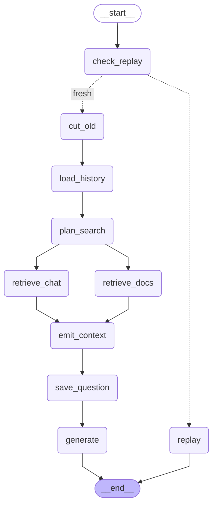

# The chat turn as a LangGraph graph

`backend/retriever/turn.py` runs one chat turn (question in, saved answer out)
as a LangGraph `StateGraph`. The graph is wired in `backend/retriever/turn_graph.py`;
every node function lives in `turn.py`.

This diagram is generated from the compiled graph, not drawn by hand. To make
it again (from `backend/retriever`, with the same environment variables the
tests set):

```
python -c "import turn, turn_graph; print(turn_graph.get_graph(turn._graph_nodes()).get_graph().draw_mermaid())"
```



## What is NOT in the graph

`run_turn` still does these before the graph starts, in plain code:

1. **Authorize the chat** (`get_or_create_conversation`). A user who does not
   own the chat is refused before they can take a claim.
2. **Check the chosen documents** (`DocumentNotFound`, `DocumentNotReady`).
3. **Claim** `(conversation_id, user_message_id)`, and **release** it in a plain
   `try/finally`.

Why: a foreign user must never occupy a claim key and make the real user wait
up to 60 seconds, and the release must run even when the turn is cancelled.

## Why there is only ONE `generate` node

Streaming the answer and saving it are the same node on purpose.

When the user presses Stop, the caller cancels the turn and the graph stops.
Nodes after the running one never start. A separate `save_answer` node placed
after `generate` would therefore never run, and the partial answer would be
lost. In one node, the save sits in a `finally` block and runs shielded
(`asyncio.shield`), so a Stop (or even a second cancel) still keeps what was
written.

The same node also keeps the rule "a failed model call saves nothing": the
save is skipped when the stream raised.

## Other decisions

- **Events are not state.** `Context`, `Token` and `Done` are sent through
  LangGraph's custom stream (`get_stream_writer()` in the node, `stream_mode="custom"`
  in `run_turn`). `run_turn` re-yields them, so it is still an async generator
  with the same signature and the same event order.
- **No checkpointer.** SQLite and Qdrant stay the only places where anything is
  saved.
- **The two searches run in parallel.** `plan_search` has two edges out
  (`retrieve_chat`, `retrieve_docs`) and `emit_context` is joined to both
  (`add_edge([...], "emit_context")`), so it waits for both. They write
  different state keys (`chat_results`, `doc_results`), so no reducer is
  needed. The question is still embedded once, in `plan_search`, before the
  fan-out. Each search swallows its own errors, so one failing never stops the
  other or the answer. The `_jobs` semaphore still limits CPU work to 4 at a time.
- **The question is saved after both searches** (`save_question` comes after
  `emit_context`, which waits for both searches), so it cannot retrieve itself.
- **Not done on purpose:** a retry edge for the Groq call (see below) and moving
  the claim into the graph (the claim is per process; it only makes sense in the
  graph together with a database lock).
- **The graph is built once per `turn` module** (`get_graph(turn._graph_nodes())`).
  `run_turn` hands over its own node functions instead of letting `turn_graph`
  do `import turn`: the tests load a private copy of `turn` with fake modules,
  and its nodes must be the ones that run.
- **Log order:** the two search nodes can log in either order, because they run together.
- **One log line per node:** `node=<name> ms=<int>`, never any question, answer or
  document text. The request id comes from the logging context.

## Why the Groq retry was not added

LangGraph's `RetryPolicy` re-runs a whole node. `generate` streams tokens to the
client as it goes, so a re-run after the first token would send the start of the
answer twice. A safe retry would have to live inside `generate`, only for a
connection error before the first token, and `main.py` already turns Groq
errors into gRPC status codes the frontend handles. Add it only if connection
errors show up in real use.